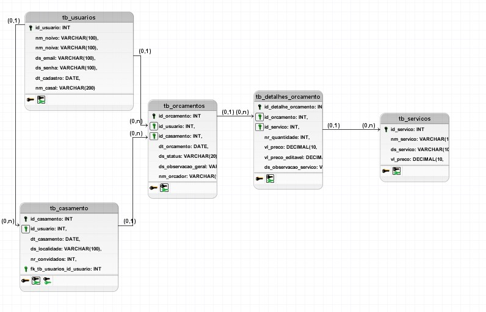
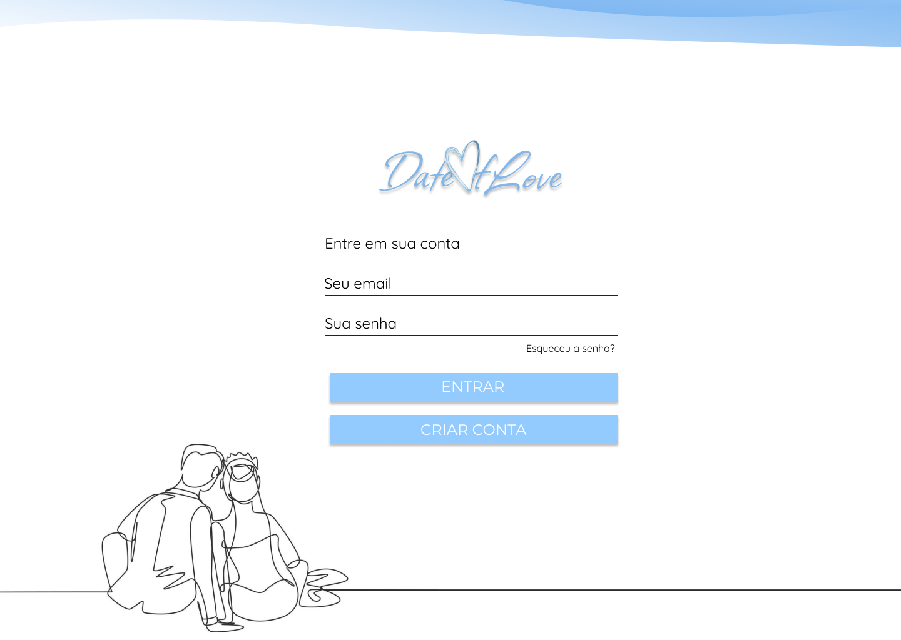
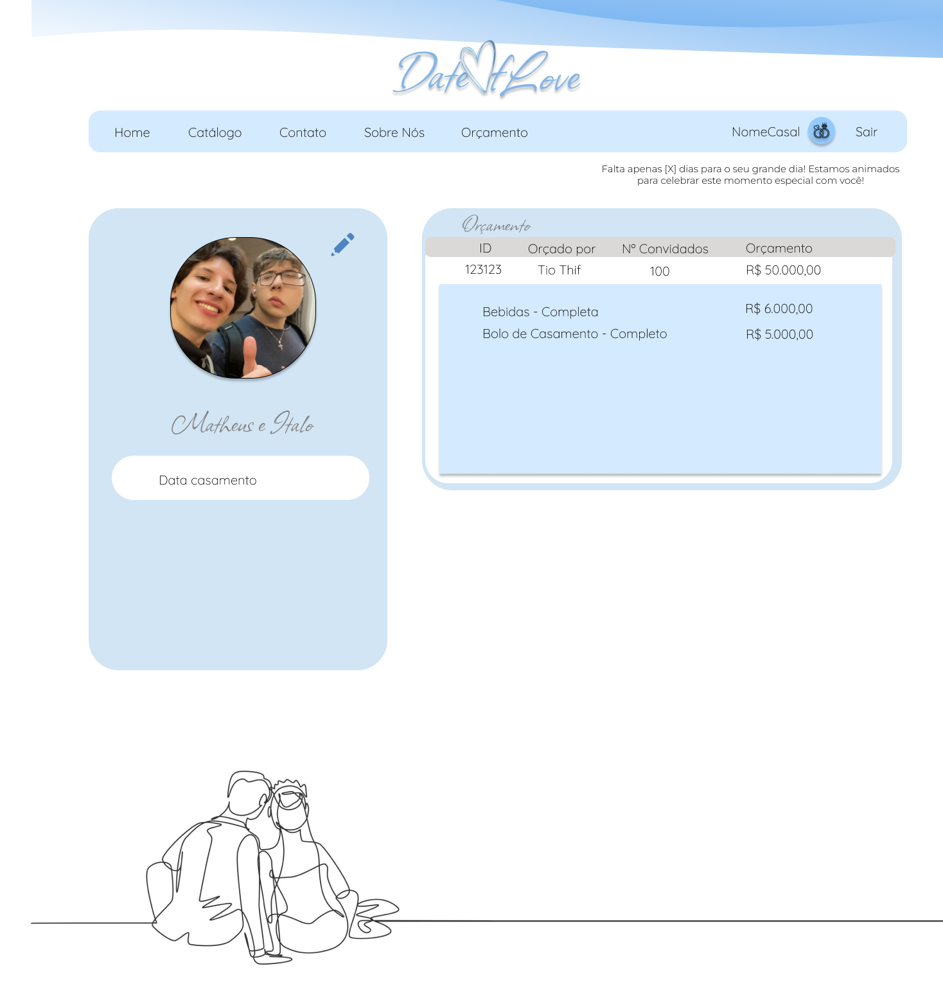
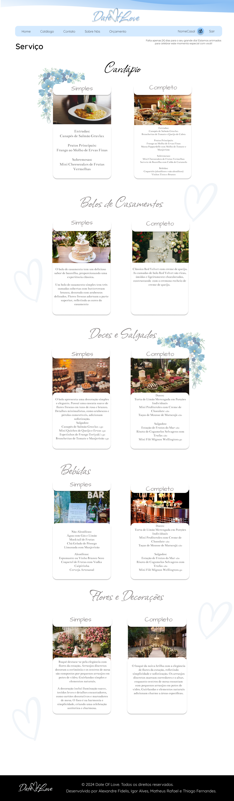
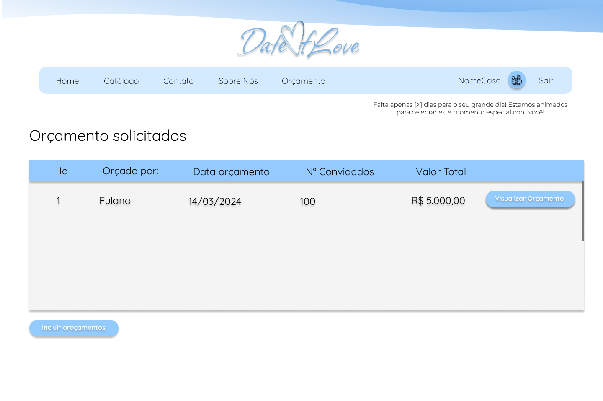

# 💍 Date Of Love – Organização de Festas de Casamento

## 📌 Descrição

O **Date Of Love** é uma plataforma online especializada na **organização de festas de casamento**, criada para simplificar o processo de planejamento e transformar cada etapa em uma experiência memorável.

O sistema permite que casais explorem serviços, personalizem detalhes do evento e gerem **orçamentos completos**, tudo em um único ambiente digital.

---

## 🚀 Requisitos Principais

- **Cadastro e Login**  
  Sistema de autenticação para acesso às informações do casal e histórico de orçamentos.

- **Catálogo de Serviços**  
  Listagem completa de serviços e produtos relacionados a festas de casamento.

- **Escolha de Serviços**  
  Seleção de itens como decoração, buffet e música, com personalização de local e número de convidados.

- **Geração de Orçamentos**  
  Criação automática de orçamentos detalhados com base nas escolhas do usuário.

---

## ✨ Funcionalidades Adicionais

- **Disparo de E-mails Automáticos**  
  Envio de lembretes e avisos importantes sobre o evento.

- **Chat de Contato**  
  Canal direto de comunicação entre usuários e equipe de suporte.

---

## 🖥️ Telas e Funcionalidades

### 👤 Público (Usuário)

1. Home  
2. Serviços  
3. Login / Criar Conta  
4. Catálogo de Serviços  
5. Seleção de Serviços para Orçamento  
6. Histórico de Orçamentos  
7. Visualizar Orçamento  
8. Perfil do Casal  
9. Suporte / Dúvidas  

### 🛠️ Administrador (ADM)

1. Listagem de Orçamentos  
2. Visualização e Alteração de Orçamentos  

---

## 📊 Diagrama DER

---

## 🎨 Protótipo (Figma)

🔗 https://www.figma.com/file/y73G9AIo4N6H5Y49imq0oc/Date-of-Love

---

## 🖼️ Telas do Sistema

### Interface do Usuário

### Administração (ADM)

